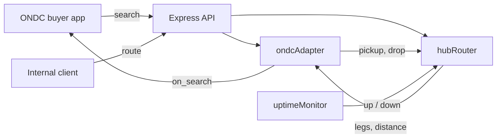

# Architecture

Spoke-Grid models a delivery network as a set of **hubs** (sorting and transfer points with limited capacity) and **spokes** (pickup and drop points that feed a hub). Parcels never travel spoke to spoke. They always go through at least one hub.

## Request flow

## Modules

### `src/services/hubRouter.js`

Holds hubs and spokes in memory. For a pickup and a drop it:

1. Resolves each point. A point is a latitude and longitude, or a `spokeId` that is looked up.
2. Finds the nearest hub that is `up`, has at least one unit of free capacity, and sits within `MAX_SPOKE_RADIUS_KM`.
3. Builds the legs. When both points map to the same hub there are two legs (first mile, last mile). Otherwise a linehaul leg joins the two hubs.
4. Optionally reserves one unit of capacity on each distinct hub. `release()` undoes a reservation.

Distances use the haversine formula on straight lines. They are estimates, not road distances.

### `src/services/ondcAdapter.js`

Translates between ONDC logistics messages and the router.

- `parseSearch` reads the `start` and `end` GPS strings from a `search` intent.
- `estimatePrice` charges a base fee plus a per-kilometre rate in INR.
- `estimateMinutes` adds travel time per leg type to two hours of handling at each hub touched. Last-mile and first-mile legs assume 25 km/h and linehaul assumes 45 km/h.
- `buildOnSearch` echoes the transaction and message ids from the request and wraps the result in a catalog with one item.

The HTTP route answers with the `on_search` body directly. A production BPP would acknowledge the request and POST the callback to the buyer app.

### `src/telemetry/uptimeMonitor.js`

Probes each hub on an interval and keeps a rolling window of results (20 by default). Three failures in a row mark a hub `down`, which removes it from routing. The next success marks it `up`. The probe is injectable, so tests and deployments can supply their own check. The default probe calls a hub's `healthUrl` when it has one.

### `src/index.js`

Builds the Express app from the pieces above. `createApp()` returns the app and its services without opening a port, which keeps tests fast. The server and the probe timer only start when the file is run directly.

## Capacity and failover

Capacity is a count of parcels in flight per hub. Reservations are opt-in, so a plain quote never changes state. When a hub is full or down, the next nearest hub within range is used. If none qualifies the API returns `422 NO_HUB_IN_RANGE`.

## Limits in v1.1.0

- State lives in memory. A restart clears hub load and probe history.
- There is one price and one service level. Weight and size do not affect routing.
- ONDC messages are not signed, and only `search` is implemented.
- Distances are great-circle estimates.

## Extending

- Persist hub load in a database and release it when a parcel is delivered.
- Add `select`, `init` and `confirm` handlers to the adapter.
- Replace `estimatePrice` with a rate card keyed on weight and zone.
- Swap the straight-line distance for a road routing service behind the same `route()` result shape.
